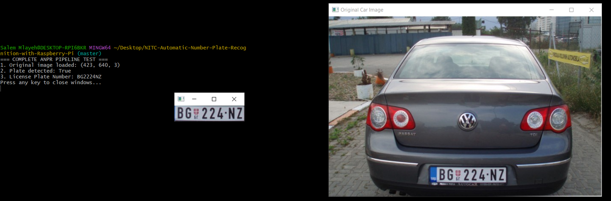
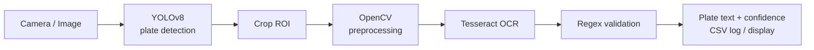
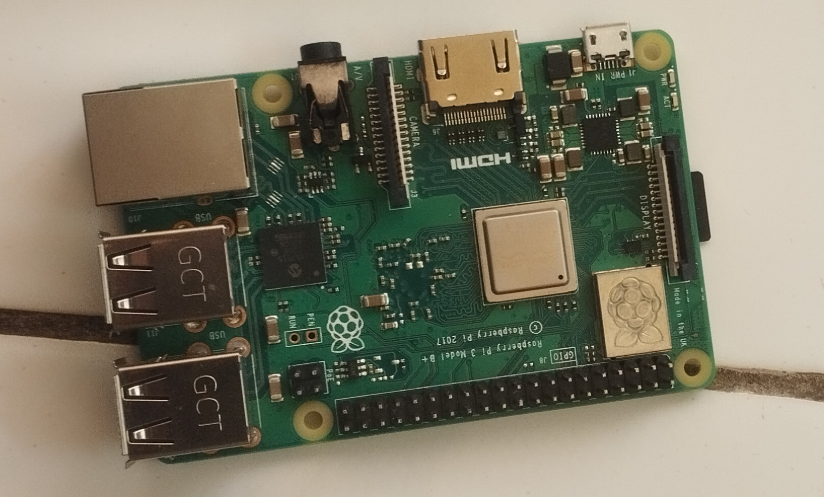
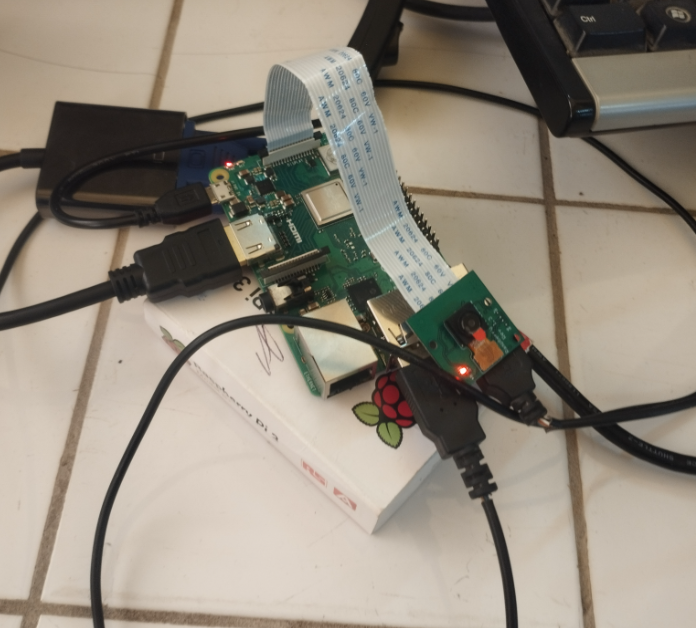
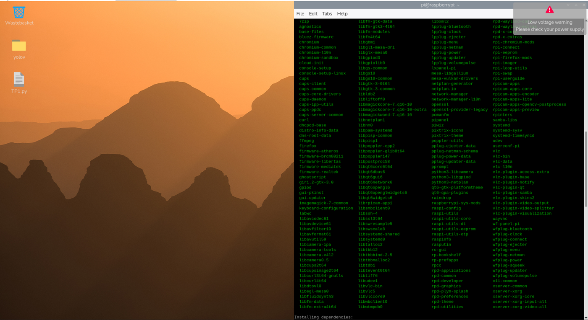

# 🚗 ANPR on Raspberry Pi — YOLOv8 + OpenCV + Tesseract

Automatic Number Plate Recognition (ANPR) for embedded vision. The system detects a license plate with **YOLOv8 (PyTorch)**, cleans the crop with **OpenCV**, reads the characters with **Tesseract OCR**, and validates the result with **regular expressions**. It is designed to run on a **Raspberry Pi 3** with a camera module.

   

---

## 📑 Table of Contents

1. [Demo](#-demo)
2. [Features](#-features)
3. [How it works](#-how-it-works)
4. [Project structure](#-project-structure)
5. [Hardware](#-hardware)
6. [Installation](#-installation)
7. [Usage](#-usage)
8. [Training your own detector](#-training-your-own-detector)
9. [Configuration](#-configuration)
10. [Raspberry Pi optimization](#-raspberry-pi-optimization)
11. [Results](#-results)
12. [Troubleshooting](#-troubleshooting)
13. [Experimental: VLM extension](#-experimental-vlm-extension)
14. [Roadmap](#-roadmap)

---

## 🎬 Demo

```text
=== COMPLETE ANPR PIPELINE TEST ===
1. Original image loaded: (423, 640, 3)
2. Plate detected: True
3. License Plate Number: BG224NZ
Press any key to close windows...
```



*A Serbian plate detected on a test image: the cropped plate (center) and the OCR output in the terminal.*

---

## ✨ Features

- **YOLOv8** plate detection (PyTorch / Ultralytics), nano model for embedded use
- **OpenCV** preprocessing: resize, bilateral filter, CLAHE, Otsu + adaptive thresholding, morphology
- **Tesseract OCR** with a character whitelist; several preprocessing variants are tried and the best one wins
- **Regex validation** with country-specific patterns (configurable)
- **Live mode** for the Pi camera (`picamera2`) or any USB webcam, with CSV logging
- **Modular design**: detection, preprocessing, OCR and pipeline are independent modules
- *(Optional)* remote VLM client for contextual image questions

---

## 🧩 How it works



| Stage | Module | What it does |
|---|---|---|
| 1. Detection | `anpr/detector.py` | YOLOv8 returns plate bounding boxes sorted by confidence |
| 2. Preprocessing | `anpr/preprocess.py` | Crop with padding, upscale, denoise, binarize (3 variants) |
| 3. OCR | `anpr/ocr.py` | Tesseract on each variant; picks the best valid result |
| 4. Validation | `anpr/ocr.py` | Regex check against `PLATE_PATTERNS` |
| 5. Orchestration | `anpr/pipeline.py` | Runs everything and draws annotated output |

**Evolution of the project:** traditional CV (thresholding, edges, contours) → CNN-based detection → YOLOv8. The classical approach was sensitive to lighting, background and plate angle, which motivated the move to learned detection.

---

## 📁 Project structure

```text
.
├── anpr/
│   ├── __init__.py
│   ├── config.py            # all settings in one place
│   ├── detector.py          # YOLOv8 wrapper
│   ├── preprocess.py        # OpenCV helpers
│   ├── ocr.py               # Tesseract + regex validation
│   ├── pipeline.py          # end-to-end ANPRPipeline
│   └── vlm_client.py        # optional remote VLM client
├── scripts/
│   ├── export_model.py      # export weights to NCNN / ONNX for the Pi
│   └── vlm_demo.py          # optional VLM demo
├── models/                  # trained weights (best.pt) go here
├── data/
│   ├── samples/             # extra test images
│   └── plate_samples/       # cropped plate images for testing OCR alone
├── legacy/                  # original first-version scripts (kept for reference)
├── docs/images/             # README pictures
├── CarPictures/             # 11 sample test images (Serbian and Indian plates)
├── images/                  # original project images
├── train_yolo.py            # train the detector (PC / Colab)
├── test_complete_pipeline.py# quick single-image test
├── run_camera.py            # live ANPR with logging
├── data.yaml                # YOLO dataset config
└── requirements.txt
```

**About `legacy/`:** it contains the original scripts from the first version of the project (`ImageCapture.py`, `PlateExtraction.py`, `OpticalCharacterRecognition.py`, `improved_video_detector.py`). They are kept for reference; the modular `anpr/` package replaces them.

---

## 🔧 Hardware

- Raspberry Pi 3 (Model B / B+)
- Raspberry Pi Camera Module (CSI ribbon cable)
- Stable **5V / 2.5A** power supply (see [Troubleshooting](#-troubleshooting))
- microSD card (16 GB+), HDMI display or VNC access

<p align="center">
  
  
</p>

*Left: Raspberry Pi 3 board. Right: the Pi with the camera module connected through the CSI ribbon cable.*

Remote setup over VNC (installing dependencies on Raspberry Pi OS):



---

## 📦 Installation

### On a PC (development / training)

```bash
git clone https://github.com/salemmlayeh/Reconnaissance-automatique-des-plaques-d-immatriculation-ANPR-.git
cd Reconnaissance-automatique-des-plaques-d-immatriculation-ANPR-

python -m venv .venv
source .venv/bin/activate        # Windows (Git Bash): source .venv/Scripts/activate
pip install -r requirements.txt
```

Install the **Tesseract binary**:

- **Windows:** installer from the UB Mannheim build, then set `TESSERACT_CMD` in `anpr/config.py`
- **Linux:** `sudo apt install tesseract-ocr`
- **macOS:** `brew install tesseract`

### On the Raspberry Pi

```bash
sudo apt update
sudo apt install -y tesseract-ocr python3-opencv python3-picamera2 python3-venv

python3 -m venv --system-site-packages .venv   # keeps apt's OpenCV and picamera2
source .venv/bin/activate
pip install ultralytics pytesseract
```

> The Pi 3 has only 1 GB RAM. Use a 64-bit Raspberry Pi OS if possible, and increase swap for the install (`sudo nano /etc/dphys-swapfile`).

---

> **Model weights:** the trained `best.pt` file is not stored in this repository. Train your own detector (see the *Training your own detector* section below) and place the result in `models/best.pt`.

## ▶️ Usage

**Test on one image** (the repo includes sample photos in `CarPictures/`)

```bash
python test_complete_pipeline.py CarPictures/001.jpg
python test_complete_pipeline.py CarPictures/001.jpg --no-gui   # headless / SSH
```

**Live camera with logging**

```bash
python run_camera.py --show --every 5 --log plates.csv
```

**Use it in your own code**

```python
import cv2
from anpr import ANPRPipeline

pipeline = ANPRPipeline()
for plate in pipeline.process(cv2.imread("car.jpg")):
    print(plate.text, plate.valid, plate.ocr_conf)
```

---

## 🏋️ Training your own detector

Train on a PC or Google Colab, **not** on the Pi.

1. Prepare a YOLO-format dataset (`images/train`, `images/val`, `labels/...`) and edit `data.yaml`.
2. Train:
   ```bash
   python train_yolo.py --data data.yaml --epochs 50 --imgsz 640
   ```
3. Copy `runs/plates/weights/best.pt` to `models/best.pt`.
4. (Pi only) export to a faster format:
   ```bash
   python scripts/export_model.py --weights models/best.pt --format ncnn --imgsz 320
   ```
   Then set `MODEL_PATH = ROOT / "models" / "best_ncnn_model"` in `anpr/config.py`.

---

## ⚙️ Configuration

Everything lives in [`anpr/config.py`](anpr/config.py):

| Setting | Purpose |
|---|---|
| `MODEL_PATH` | YOLO weights or exported model folder |
| `DET_CONF`, `IMG_SIZE`, `DEVICE` | Detection threshold, input size, CPU/GPU |
| `TESSERACT_CMD` | Path to the Tesseract executable (Windows) |
| `OCR_WHITELIST` | Allowed OCR characters |
| `LEFT_TRIM` | Cut a fraction of the plate's left side (country/EU band) |
| `PLATE_PATTERNS` | Regexes defining a valid plate for your country |

Plate formats validated by default:

| Country | Pattern | Example |
|---|---|---|
| Serbia | 2 letters + 3–4 digits + 2 letters | `BG224NZ` |
| India | 2 letters + 2 digits + 1–3 letters + 4 digits | `MH12DE1433` |

To add another country, append a regex to `PLATE_PATTERNS`.

---

## ⚡ Raspberry Pi optimization

- Use **YOLOv8n** with `imgsz=320` and an **NCNN** export
- Process every Nth frame (`--every 5`) instead of every frame
- Keep detection and OCR as separate stages; run OCR only on detected crops
- Measure latency and RAM (`htop`, `time.perf_counter()`) before changing models
- Run the GUI only when needed (`--show`); headless is faster

---

## 📊 Results

The original project reported a **character recognition rate above 92 %** on its test data.

| Component | Evaluation focus |
|---|---|
| Traditional CV | Plate localization, sensitivity to lighting and angle |
| YOLOv8 + Tesseract | Detection quality, character accuracy, end-to-end accuracy |
| VLM extension | Answer relevance, consistency, latency (separate from ANPR accuracy) |

Future benchmarks should use the same test images and clearly defined metrics (detection mAP, character accuracy, full-plate accuracy, FPS on the Pi).

---

## 🛠️ Troubleshooting

| Problem | Fix |
|---|---|
| `can't open file 'test_complete_pipeline.py'` | Run the command from the project root folder |
| `TesseractNotFoundError` | Install Tesseract and set `TESSERACT_CMD` in `config.py` |
| Extra character in output (e.g. `BG2224NZ` instead of `BG224NZ`) | The coat-of-arms/emblem on the plate is read as a digit. Increase `LEFT_TRIM` (try `0.08`–`0.12`) and keep a strict regex |
| ⚠️ *Low voltage warning* on the Pi | Use a proper 5V/2.5A supply and a short, good-quality cable; low voltage causes crashes and slow inference |
| Very slow inference | Lower `IMG_SIZE`, export to NCNN, process fewer frames |
| Camera not detected | Check the ribbon cable orientation and run `rpicam-hello` |

---

## 🔬 Experimental: VLM extension

A small optional module (`anpr/vlm_client.py`) can send an image and the OCR output to a **vision–language model running on a separate computer** (e.g. Ollama + LLaVA) and ask questions such as *"Describe the visible vehicle."* The Pi 3 is too limited to run a VLM locally.

VLM answers are generated text, **not verified plate readings** — YOLOv8 and Tesseract remain the source of truth for plate text. Try it with `python scripts/vlm_demo.py CarPictures/001.jpg`.

---

## 🗺️ Roadmap

- [ ] Benchmark traditional CV vs. YOLOv8 on the same dataset
- [ ] Measure latency and memory on the Pi 3
- [ ] Evaluate across lighting and viewing conditions
- [ ] Add per-country plate format profiles
- [ ] Lightweight web interface for live results
- [ ] Evaluate whether OCR context improves VLM answers

---

## 📄 License

Released under the [MIT License](LICENSE).

## 👤 Author

**Salem Mlayeh** — [GitHub](https://github.com/salemmlayeh)
